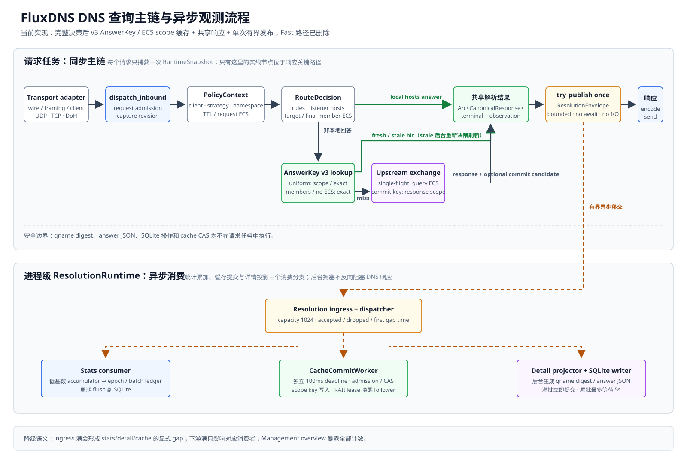

# DNS 请求管线实现

> 文档状态：有效
>
> 适用范围：正式 transport、Policy、Cache、Upstream 与单次完成事件链路
>
> 最后核对：2026-09-08（客户端管理键/请求身份索引与 mapped IPv4 定向验证；其余正文沿用原核对范围）
>
> 核对基线：`16a395887cf4c1182e72600aceb591310991d97d` 加本次 BC-04 工作树
>
> 2026-09-06 增量核对：仅更新真实会话边界的连续恢复与 reload 驱动；其余正文保留上述历史核对范围
>
> 2026-09-21 增量核对：仅更新缓存 `expired` 状态、过期保留期与相关写回 CAS 语义；其余正文沿用上述历史核对范围
>
> 同日文档收口：结束剩余验证专项，维持 body 断流分类与重试行为；本次仅核对源码分类和文档引用，未新增运行验收
>
> 2026-09-21 增量核对（本机日期）：仅核对 `dns/policy.rs` 的 group ECS、Resolved key、optimistic refresh 与 late-result 接纳；未刷新其余历史验收结论
>
> 增量核对基线：`e50b948edb4699f58a1e57039fb56442ab228687`（v0.2.9）加本次缓存修复工作树；最终验收仅静态检查/编译，范围见[缓存修复验证](#缓存修复验证)
>
> 2026-11-07 增量核对：`aa0fedf` 加本次工作树，仅更新 DoH 显式裸路径、必填 client ID 和路由优先级；其余历史范围沿用原记录
>
> 2026-11-08 增量核对：基线 `bfece26` 加本次工作树，仅核对 DoH 裸路由隐式 ID 后缀、必填显式模板与优先级；本次验证见[能力与证据](#能力与证据)，其余历史范围未重新核对。
>
> 2026-11-08 短响应缓存增量核对：基线 `96daf34376bcc108efacffdf620144ba5fd0bb54` 加本次工作树，仅核对 REFUSED/空 Answer 的 10s 生命周期、客户端 TTL、无 stale 与 entry v3 恢复；证据见[短响应缓存验证](#短响应缓存验证)。
>
> 2026-11-09 答案缓存增量核对：基线 `08a774724e2304f72dd7b8d0a9d0299983f9b0e5` 加工作树，核对 v3 AnswerKey、target 子树摘要、成员 ECS、scope 索引与 refresh/late-result；本轮全量后端测试和 loopback 二进制验收见 [v3 答案缓存核对边界](#v3-答案缓存核对边界)，其余历史结论不自动刷新。

## 入口与调用链

> 2026-09-22 增量核对：`2b3b160` 加本次工作树。入站请求新增共享 `RequestTrace`，transport 写出结束后冻结响应耗时，后台 cache write/refresh 记录各自实际结果；不改变 core 完成事件、响应选择或缓存准入。详情聚合、持久化及验证证据统一见[执行事实与后台分发](background-services.md#完成事件与后台分发)。

[`service.rs`](../../../backend/src/service.rs) 根据 typed binding 启动 UDP、TCP 和 DoH task；`run_adapter_loop` 把 adapter 产出的请求交给 instrumented core，再编码写回。TCP/DoH listener 用内部 `JoinSet` 管理 session，不把 DoH 当成 raw DNS/TCP。

```text
SystemSocketFactory / typed binding
 -> transport adapter -> DnsRequest + RequestContext
 -> instrumented DnsCore::resolve_with_completion
 -> PolicyDnsCore -> PolicyContext -> RouteDecision -> local hosts answer
 -> otherwise: prepare_query -> v3 AnswerKey lookup / single-flight / UpstreamRegistry
 -> canonical response + completion
 -> ResolutionEventSink::try_publish -> transport response encoding
```

[`transport/wire.rs`](../../../backend/src/transport/wire.rs) 分离请求 DNS ID 与 canonical message；response encoder 恢复本次 ID、TCP framing 或 DoH envelope，UDP 按 EDNS 尺寸截断副本，不污染共享缓存。



图中三个消费分支不表示三条额外下游队列；实际队列是 resolution ingress、cache commit 和详情投影，stats 由 dispatcher 直接累加，详见[后台服务](background-services.md)。

## Policy 与实际 core

正式 async prepare 在 [`dns/policy.rs`](../../../backend/src/dns/policy.rs) 构造 `PolicyDnsCore::from_config_with_resource_snapshots`；不另设仅处理 hosts 的配置装配层。每个请求先由 `prepare_context` 选 client/strategy/cache namespace，随后 `evaluate_route` 完成 listener hosts 与有序规则，再组合 `ResolutionPlan` 和最终成员 ECS。Fast 分支及 eligibility/memo 已删除；cache lookup 不再跳过规则决策。

配置 route 由 [`config/doh_route.rs`](../../../backend/src/config/doh_route.rs) 的 `DohPathPattern` 共享编译。裸路由既精确匹配原文路径（`client_id = None`），也接受追加一个非空 ID 段；尾随斜杠追加时沿用已有斜杠，根路径 `/` 同时支持 `/` 与 `/client-a`。显式模板中的 client ID 段必须非空、不可省略，不接受额外多段。`specificity_cmp` 将裸路由隐式 ID 后缀纳入逐段固定段优先比较，同样段结构下显式模板优先，供 Config 同优先级歧义校验和 [`DohAdapter::new_with_tls`](../../../backend/src/transport/doh.rs) 装配期排序共用；`/dns` 与 `/dns/` 的隐式 ID 集合重叠且同优先级，不能共存。DoH adapter 按已排序路由匹配真实路径后，将配置 `path` 原文传为 typed canonical route ID，不合成模板、不改写配置；Policy 不重新匹配 URL，请求热路径不重新排序。所有入口保留 endpoint 的来源 IP 提取规则，无 ID 时进入现有 CIDR 匹配，有 ID 时精确 ID 优先、未注册 ID 按 IP 回退，路径 ID 不是认证。完整匹配样例、固定 inner 路由及短路径被其他路由捕获的边界见[配置参考](../configuration.md)。资源-only publish 更新 core 内的资源 snapshot，后续请求使用新 hash；不依靠全局 cache clear。

`dns/policy.rs` 同时含具体 adapter 的构造代码，包括 `UpstreamRegistry` 和 Moka cache；解析方法通过 port 使用它们，并把具体 Moka source 交给进程级 snapshot owner。不能把设计中的“公共接口不泄漏 adapter 类型”扩大为“整个 dns 源目录不 import adapter”。旧 SQLite/File cache adapter 与增量持久化链已删除，只保留 FDCS 使用的记录编码和进程级快照 owner。

`MemoryCacheStore`、`InMemoryStorageBackend` 和 `HostsCore`/`ServFailCore` 不在正式请求装配中。前两者用于与 Moka/SQLite 共用的 adapter 契约测试；后两者用于简化解析、dispatch/Transport 测试。它们不是查询性能优化，也不应为了清理名称相似的代码而删除生产 `MokaCacheStore`、`SqliteStorageBackend`、`PolicyDnsCore` 或 hosts upstream 使用的 `HostsTable`。

`ResolvedClient` 与 `ClientRule` 显式区分配置管理 `name` 和请求 `client_ids`。`ClientIndex` 分别构建 name/exact ID 索引，ID 保持大小写敏感且优先于 IP；client CIDR 按前缀长度降序扫描，IPv4-mapped IPv6 在匹配与 cache digest 前归一化为 IPv4。生产 v2 loader 把单个 `client_id` 直接编译到运行时索引；复数容器只是内部统一形态，不表示配置仍接受 `match.ids`。hosts 使用 BTreeMap，rule exact/suffix 使用 BTreeSet，随后依次匹配 keyword/受限 regex。当前没有 CIDR/suffix trie。PolicyState 的 matcher/version/hash 一起发布，Runtime metadata 随后更新，不是跨两个 ArcSwap 的事务。

## Cache 与 TTL

`build_cache_facade` 的生产默认是 [`MokaCacheStore::with_max_weight`](../../../backend/src/cache/moka.rs)，不是测试用 [`MemoryCacheStore`](../../../backend/src/cache/memory.rs)。共享 store 通过 namespace 形成逻辑池；所有 subnet/namespace 记录共享全局 weight，没有每 base 条目上限。v3 [`AnswerKey`](../../../backend/src/cache/key.rs) 由 namespace、transport compatibility、target 子树 fingerprint、规范化 question、RD/CD/DO、排序保留 EDNS options 与最终成员 ECS 构成；EDNS 存在本身不入 key。ECS 单独编码，DNS ID、COOKIE、PADDING、TCP keepalive 和 UDP payload size 不入 key，未知 option 保守保留。入口/客户端/policy/request/资源 hash 不再进入答案身份。

[`target_fingerprint`](../../../backend/src/dns/policy.rs) 预计算每个 target 的 group 成员/权重/fallback/模式/超时/嵌套结构，以及 direct 的完整 DoH URL（含 path/query）、connect_ip、bootstrap 链、所用 outbound 与上游 hosts 内容。outbound 摘要由 [`UpstreamRegistry`](../../../backend/src/upstream/registry.rs) 复用 connector 已解析的 profile 产生，不二次读取 SecretRef，不持久化凭据明文。无关 target 配置、规则或本地 hosts 更新不改变摘要；同 namespace 内不同入口/身份/策略在 target 与最终查询相同时共享答案，需要隔离则显式选择 client/strategy 池。

- listener/strategy hosts 本地回答绕过 response cache；upstream hosts 按普通上游响应处理。
- `UpstreamRuntime::prepare_query` 遍历 primary/fallback/nested 的全部 direct leaves。rule/strategy/client 显式 ECS 统一覆盖成员，否则成员 upstream 覆盖 global、未显式成员继承请求级 ECS。最终 ECS 相同则 uniform；异构时按成员 ID 排序编码最终 ECS/None 的摘要，并把 per-member query 交给 executor，正常参与精确 lookup、single-flight 和 commit。
- `normalize_client_subnet` 将合法请求 ECS 的 source 截断到 IPv4 /24、IPv6 /56，较短前缀保留，清除 host bits，scope 置 0；缺失合法 ECS 时由客户端地址推导。custom CIDR 保持配置前缀、scope 置 0。
- 缓存候选保留 canonical upstream origin response。`CanonicalResponse::short_cache_ttl` 统一识别 REFUSED（包含非空 Answer）和所有空 Answer 响应，[`admit_response`](../../../backend/src/cache/admission.rs) 固定写入 10s 且不设 stale 窗口。上游输出与 fresh 命中由 `rewrite_short_cache_ttl` 改写 RR TTL/SOA.MINIMUM 为 10s/剩余寿命，无记录时不合成记录；短响应跳过 TTL override。`stale_answer_ttl` 直接拒绝短响应；越过应答窗口的可见条目返回 `Expired`，不混同 `Miss`。
- `probe_answer` 使用 Moka covering 前缀计数索引，经 `AnswerKey::probe_keys` 从长到短探测不超过查询 source 的 covering key，最后 exact；选择当前池允许返回的最长前缀答案，较宽 fresh 不越过可返回的更具体 stale。`load_key` 按查询 ECS 精确合并 single-flight；`storage_key(response.edns_client_subnet())` 在应答后确定实际存储网段。scope/exact、source 0 与无 ECS 桶的完整矩阵见 [Cache 设计](../../architecture/backend/modules/cache.md#4-lookup-与-single-flight)。应答不带 ECS 或应答 ECS 不一致时按查询 source 存储（source 0 仍为 exact /0），不一致应答仍正常返回与缓存；异构摘要不参与 scope 匹配。
- [`MokaCacheStore`](../../../backend/src/cache/moka.rs) 的 `CoveringIndex` 按 base/前缀计数，每次写入新版本增加，所有移除通知（含替换）减少旧版本计数，覆盖读写之间淘汰的交错；恢复使用插入路径重建，不单独持久化。索引只引导探测，不能替代真实 key/生命周期检查。
- `schedule_optimistic_refresh` 切到最新 core 重新执行 `prepare_cache_query`，目标 fresh 则跳过。回源前记录 `snapshot_generation()` 水位，响应后写前再次核对 AnswerKey。新 scope key 按 probe 的 Version/Absent CAS；成功 Inserted/Replaced 后调用 `invalidate_covered(key, version, before_refresh)`，在 store 锁内核对新版本仍有效，仅清除被完整覆盖且版本不晚于水位的旧条目，保护刷新期间更新。新条目已失效/替换不清理，失败不延长旧 stale。
- `PolicyLateResultSink` 保存 AnswerKey、不保存 policy semantics。latest core 重新准备及写前均要求答案身份相等；policy/资源改变但 target/最终查询不变仍可接纳。按应答 scope 计算目标 key，fresh/stale 已有同等或更高质量则跳过；expired 按版本替换，不当作 Absent。
- `cache_scope/ecs_mismatch`、`cache_refresh` 与 `cache_late` debug 事件只记录低基数 reason/outcome/配置 ID，不输出明文 ECS 或客户端 IP；异构绕过的 `group_ecs_differs` 事件已删除。`cache_refresh` 仍带实际写回 `class` 与 `ttl_secs`。
- `CacheActivity` 的 `response_class`（positive/nodata/nxdomain/servfail/truncated/refused/other）与 `ttl_secs` 由 `CacheCommitCandidate::commit` 和后台刷新在实际得到写回候选时通过 `CacheActivityGuard::result` 记录，TTL 取 `cache_written_ttl_secs`（写入条目的剩余寿命）。两字段在 serde 中带默认值，旧详情 `execution_json` 仍可读取，缺失时为 null。
- Core 将持有 single-flight lease 的 `CacheCommitCandidate` 随完成事件交出；[`resolution.rs`](../../../backend/src/resolution.rs) 的 cache worker 在独立 deadline 内 CAS。candidate drop 必须唤醒 waiter，响应不等待写回。

进程快照的恢复、周期、generation 和失败见[后台服务](background-services.md)；准入与终态约束见 [Cache 设计](../../architecture/backend/modules/cache.md)。

### v3 答案缓存核对边界

2026-11-09，Windows x86_64，mise 声明的 Rust/Cargo 1.98.0，基线 `08a7747` 加本次工作树，实际执行：

| 检查 | 结果 |
| --- | --- |
| `cargo test --offline --locked --manifest-path backend/Cargo.toml -- --test-threads=1` | 913 passed、0 failed、5 ignored；含 4 项既有显式专项和 1 项新增微基准 |
| `cargo clippy --offline --locked --manifest-path backend/Cargo.toml --all-targets -- -D warnings` | 通过 |
| `cargo build --offline --locked --manifest-path backend/Cargo.toml` | 通过；使用该 debug 二进制运行验收 |
| `cargo fmt --manifest-path backend/Cargo.toml -- --check`、文档检查器、`git diff --check` | 通过 |
| `cargo test --offline --locked --release --manifest-path backend/Cargo.toml scope_probe_benchmark -- --ignored --nocapture` | 1 项通过；单独执行，不作为时延门禁 |

[`policy_scope_tests.rs`](../../../backend/src/dns/policy_scope_tests.rs) 覆盖 IPv4/IPv6 scope 矩阵、source 0 与无 ECS 隔离、不一致应答原样返回、最长前缀（含 stale）、刷新扩域和并发版本保护、索引替换/清理/快照重建、客户端前缀上限，以及跨 listener/route/client/strategy 与资源更新后的实际命中。target 摘要测试覆盖无关上游不失效、完整 DoH URL 改变和同 SecretRef 文件内容改变后的 connector 重建。异构 group single-flight、TTL/短响应、晚到结果与跨 runtime 刷新继续由 [`policy_cache_tests.rs`](../../../backend/src/dns/policy_cache_tests.rs) 和既有 suite 回归。

本地运行使用 `_fluxdns/cache-scope-1794234306582/config.yaml`，`work.path: ./` 解析到同目录；报告、驱动、数据库与日志均留在该忽略目录。Node 26.8.1 可控 HTTP 上游（loopback 64345）、UDP/TCP 64346、plain DoH 64347，curl 8.21.0 发送 GET/POST，SQLite 3.53.4 核对详情。四类响应各发送 UDP、TCP、DoH POST、GET 共 16 次：scope /0 跨网段只回源 1 次，scope /24、缺失 ECS、不一致 ECS 各回源 2 次；同网段均命中。DNS ID/RCODE/Answer、HTTP 200/Content-Type、客户端 /32 截断为 /24 且查询 scope 0、不一致应答仍保留原 ECS 均符合预期；16 条详情的 `miss/fresh` 序列与回源计数一致。驱动准备阶段修正了缺失 `failure_ttl` 和过早读取异步详情的问题，未改变产品配置校验或落盘时序。测试子进程已终止，全部端口已重新绑定确认释放；这不是优雅停机验收。

微基准仅测 `probe_keys` 编码/分配：每种 100,000 次，IPv4 2/25 个索引前缀分别 33.15/258.67ms，IPv6 2/57 个前缀分别 28.06/576.82ms；不包含 store lookup、网络、规则匹配或并发负载，不代表整体 DNS 延迟。没有新增依赖、配置项或每 base 配额，容量仍受 Moka 全局 weight 约束。

key v3 使旧 key v2 快照记录按 `Incompatible` 冷启动，FDCS 外层与 entry v3 不改版；恢复会重建前缀索引，不能以 entry payload 的旧布局转换能力宣称 key v2 可恢复。未执行生产上游、真实 TLS 反代、Linux/OpenWrt、长期负载或 Docker 验收；本轮 loopback 不覆盖这些边界。

下列短响应、负缓存和缓存修复章节保留各自日期/基线的历史报告；本轮通过证据以上表为准。历史 Fast/Resolved、异构绕过与 key v2 描述只解释当时证据，当前行为以上文为准。

### 短响应缓存验证

2026-11-08，Windows Rust/Cargo 1.98.0，基线 `96daf34` 加本次工作树。实际执行 `cargo test --offline --locked --manifest-path backend/Cargo.toml --bin fluxdns cache:: -- --test-threads=1`（62 项通过）及同参数 `dns::policy::`（49 项通过）。这是本地单元/受控 adapter 验证，未部署或测试生产上游。

同一工作树随后执行全量 `cargo test --offline --locked --manifest-path backend/Cargo.toml -- --test-threads=1`：894 passed、0 failed、4 ignored；`cargo fmt --manifest-path backend/Cargo.toml -- --check`、`cargo clippy --offline --locked --manifest-path backend/Cargo.toml --all-targets -- -D warnings`、文档检查器与 `git diff --check` 均通过。工作树同时包含独立的配置写回改动，全量结果属于当时组合工作树；缓存定向证据以上面的两组测试为准。

- 原文报告（2026-11-08，本轮未复核）：[`policy_cache_tests.rs`](../../../backend/src/dns/policy_cache_tests.rs) 当时的 `short_responses_hit_age_and_expire_without_changing_rcode` 覆盖 Fast/Resolved × A/AAAA × NOERROR/NXDOMAIN/REFUSED/SERVFAIL/FORMERR/NOTIMP × 无 SOA/零 TTL/1800s SOA：首答与命中返回码不变、短 TTL 不受 300s override 放大、命中时按剩余寿命递减、到期后首查同步取得新记录，正常答案保持 origin TTL 与乐观缓存。`nodata_soa_and_client_ttl_use_ten_seconds_without_stale` 核对 SOA.MINIMUM 与 origin response 隔离。当前已无 Fast 分支，不能将此矩阵当作本轮结果。
- [`admission.rs`](../../../backend/src/cache/admission.rs) 覆盖 REFUSED 非空 Answer、TC 空响应、零/缺失 TTL 短响应准入和非空负/失败响应原策略；[`service.rs`](../../../backend/src/cache/service.rs) 的 finalizer 矩阵覆盖 REFUSED 写入及 single-flight follower 收到 Ready，准入拒绝改用零 TTL 正答案。
- 原文报告（2026-11-08，本轮未复核）：[`codec.rs`](../../../backend/src/cache/codec.rs) 当时覆盖短响应 RCODE/class/checksum 往返、保存剩余期限、过期不复活、entry v2 空响应冷启及普通答案兼容恢复；当时 key v2 与 FDCS 外层格式不变，entry v3 新增 Refused/Other。当前 key v3 的冷启边界以上文为准。

### 负缓存新鲜度验证

以下为 2026-10-04 的历史负缓存验证，不代表当前空响应仍使用 300s/乐观窗口。原 `nodata_soa_ttl_is_capped_for_cache_lifetime_and_client_ttl`、`nodata_beyond_negative_window_resolves_new_record_on_first_query` 和 `nodata_within_negative_window_serves_stale_and_records_refresh_result` 已被上面的固定短缓存矩阵替代；普通正答案乐观刷新与非空 NXDOMAIN 原策略仍有回归覆盖。

2026-10-04 实际执行 `cargo fmt -- --check`、`cargo clippy --all-targets -- -D warnings`（均通过）和 `cargo test --manifest-path backend/Cargo.toml`：830 passed、0 failed、4 ignored。同批全量运行中曾出现一次 `service::tests::idle_listener_deadlines_do_not_exhaust_transport_tasks` 在 1s UDP 接收超时处失败，单独重跑 3 次及随后全量重跑均通过，判断为并行负载下的计时抖动，与本变更无直接关系。本地 `_fluxdns/` 运行验收尚未执行，由[负缓存新鲜度计划](../../plans/negative-cache-freshness.md)跟踪。

### 缓存修复验证

本机 Windows、Rust/Cargo 1.98.0，最终编译基线为 `e50b948edb4699f58a1e57039fb56442ab228687` 加本次工作树。分析起点为 `fcbb128`；期间已发布的版本/交付变更未触及 DNS 缓存链路，验证使用实际当前 manifest（v0.2.9）。

原文报告（2026-09-21，本轮未复核）：[`policy_cache_tests.rs`](../../../backend/src/dns/policy_cache_tests.rs) 当时通过正式 `ConfigV2Loader` 加载脱敏 YAML，并使用带 origin TTL 的模拟 DoH 回答、真实缓存 facade 与有界 finalizer 等待。八组历史回归覆盖：等价 ECS 的 A/HTTPS 缓存、嵌套/重复成员与隐式 fallback、统一成员 ECS 不同于全局、真正异构 ECS 绕过和 client 子网规范化、覆盖优先级、当前 core 已发布时 Fast/Resolved stale 刷新、新 runtime 已有 fresh/stale 的更新，以及同语义/不同主机、路径、查询参数的 late-result 隔离。异构绕过和 Fast 已被当前实现删除，历史结果不构成 v3 验证。

前期开发阶段已实际执行 `cargo test --offline --locked --manifest-path backend/Cargo.toml --bin fluxdns <filter>`：`dns::policy::` 46 项、`cache::` 52 项、`runtime::` 61 项、`resolution::` 6 项，均为 0 failed、0 ignored。Policy 包含上述八组新增回归和既有快照、资源发布、并发及停机相关用例。这些是当时工作树的定向结果，不代表全量或目标平台验收。

用户随后明确本次只需静态编译，不进行完整服务启动测试。最后清理测试未使用导入后，于本机 2026-09-21 执行：

| 命令（仓库根目录） | 结果 |
| --- | --- |
| `cargo fmt --manifest-path backend/Cargo.toml -- --check` | 通过 |
| `cargo check --offline --locked --manifest-path backend/Cargo.toml --all-targets` | 通过，无编译告警 |
| `cargo test --offline --locked --manifest-path backend/Cargo.toml --bin fluxdns --no-run` | 通过，无编译告警；只构建测试程序，未执行测试体 |

最终没有启动独立 FluxDNS 服务、连接 OpenWrt、修改其配置或部署二进制；没有重新执行运行型测试、全套后端测试或前端测试，也没有交叉编译 OpenWrt target。实际设备上的命中率、长期刷新表现及资源占用尚未测量。用户将本次验收限定为静态编译，代码和文档任务据此收口，不将上述现场边界记作通过。

## Upstream 与出站

[`UpstreamRegistry::from_resolved_with_outbounds`](../../../backend/src/upstream/registry.rs) 在 core 构造时装配真实 connector；HTTPS 使用 [`ReqwestDohHttpTransport`](../../../backend/src/upstream/reqwest_http.rs)。[`tokio_outbound.rs`](../../../backend/src/upstream/tokio_outbound.rs)、[`socks5.rs`](../../../backend/src/upstream/socks5.rs)、[`bootstrap.rs`](../../../backend/src/upstream/bootstrap.rs) 提供系统 TCP、代理协商和 bootstrap 解析，Host/SNI 与连接目标保持各自语义。不是只有选择器或 fake、没有真实 I/O 的状态。

[`group.rs`](../../../backend/src/upstream/group.rs) / [`executor.rs`](../../../backend/src/upstream/executor.rs) 分离成员选择、响应择优、fallback 与 late cache candidate。正常回答（包括 NXDOMAIN）阻止 fallback；SERVFAIL/TC 与可重试失败沿用既有继续规则。parallel 在已启动的主成员中等待更好的 Positive，到阶段结束/超时后使用已收到的正常回答，不为了择优启动 fallback。late result 不改变已返回响应；主动健康检查和持久健康分数没有接入。

`from_resolved` 和正式 `from_resolved_with_outbounds` 都为每个 DoH connector 创建 [`TokioDohAddressResolver::for_upstream`](../../../backend/src/upstream/http.rs)，绑定 host/port/bootstrap 与 upstream ID。resolver 内通过 `AddressResolutionState` 查填最多一项地址答案，TTL 内不重复查询 A/AAAA；它不是 Moka response cache，也不接 Storage。

[`BootstrapResolver`](../../../backend/src/upstream/bootstrap.rs) 在每族合法回答收到时记录单调时间到期点，汇总及填状态不延长较早答案。生产 TTL 采用 0..3,600 秒，精确到期失效；零 TTL/汇总已过期的答案只供当前请求。异步 Semaphore 串行查填，等待者取得许可后复查状态；取消、超时或 drop 不泄漏许可。所有等待与查询沿用原调用者预算，命中也检查预算。错误不隐式回退 system resolver，不服务过期地址。

connector clone 共享同一 resolver；重新 prepare 创建新状态，即使配置 ID 相同也不会接收旧请求写回。Reqwest 按新地址列表选择 client pool key，Tokio direct/SOCKS5 则将新 IP 交给连接层，HTTP Host/TLS SNI 不变。connect_ip、SOCKS5H、无 bootstrap 维持原分支；未绑定配置的基础 resolver 仍不缓存。详细不变量见 [Upstream](../../architecture/backend/modules/upstream.md)。

parallel 的上述择优不依赖 sink 是否存在。Positive 提前返回时，有 late sink 就把剩余任务移交 drain，保留生产 late-result 收集；无 sink 则 abort 剩余任务。不可重试的某个 parallel 成员失败不能遮蔽其他成员有效响应，顺序模式的终止契约不变。load-balance 继续统计 primary lease，失败后按配置顺序重试，不等同逐 attempt least-in-flight。

## 能力与证据

| 能力 | 代码实现 | 正式入口接线 | 验证证据 | 已知限制 |
| --- | --- | --- | --- | --- |
| UDP/TCP/DoH | `transport/udp.rs`、`tcp.rs`、`doh.rs` | service 的 typed binding 与 session loop | 本次完整测试包含跨 UDP/TCP/DoH GET/POST 用例 | 本地 loopback，不是远程矩阵；DoH 入站非 HTTP/2 |
| TLS / 客户端地址 | system socket TLS、DoH forwarded/PROXY parser | DoH accept 后先可信 PROXY、再 TLS、再 HTTP | 本轮核对生产分支 | 真实代理、证书和故障组合仍需环境验收 |
| DoH 裸路径/隐式 ID 与显式模板优先 | `DohPathPattern::matches/specificity_cmp`、Config 校验、`DohAdapter::new_with_tls` | 所有 DoH endpoint 装配期排序，HTTP 层以配置原文选择 canonical route ID，Policy 保持原 ID/IP 索引 | 2026-11-08 Windows，`bfece26` 加本次工作树，Rust 1.98.0：`cargo test --manifest-path backend/Cargo.toml -- --test-threads=1` 全部 857 项通过、4 项既有忽略。共享匹配器覆盖可选/必填 ID、空段/多段、根路径/尾随斜杠、固定段与显式模板优先；loader 覆盖合法重叠、重复及隐式后缀歧义。fake socket 矩阵覆盖有/无显式末尾模板 × 正反顺序 × GET/POST × 9 条路径，断言 canonical route ID 与 ID/CIDR 选择；两类入口的非法路径均验证 NotFound | 首次与前端并发执行全量测试时，SQLite 锁预算用例在 30ms 连接阶段返回 Connect，856 项通过、1 项失败、4 项忽略；串行复测通过，未修改其断言或预算。会话矩阵使用真实 HTTP parser 和 ClientIndex，但未做线上代理、真实浏览器、Linux/OpenWrt 或忽略专项验收 |
| Moka / FDCS cache | `build_cache_facade`、`CacheSnapshotOwner`、二进制 codec | app 从 v2 enabled/path/interval 启动恢复、coordinator reload、service shutdown | 真实文件、跨 Policy core 重启、周期/预算/损坏/alias/代际测试；旧 SQLite adapter 测试保留 | 未验证 Unix、真实磁盘满；late-window 组合见[Late-window 与 owner](#late-window-与-owner) |
| v3 AnswerKey / ECS scope | [`key.rs`](../../../backend/src/cache/key.rs) 的 AnswerKey、[`moka.rs`](../../../backend/src/cache/moka.rs) 的 CoveringIndex/invalidate_covered | PolicyDnsCore 完整决策后的 lookup、single-flight、commit、refresh、late-result；恢复经 Moka 插入 | 2026-11-09，`08a7747` 加工作树，全量测试、Clippy、loopback 二进制及 16 条详情验收通过，见 [v3 答案缓存核对边界](#v3-答案缓存核对边界) | 未验证生产上游、跨平台、TLS 反代与长期负载；微基准不等于完整查询延迟 |
| Policy -> 出站 | core -> registry -> protocol-independent connector | 正式配置构造支持真实 HTTP/代理路径 | 本轮静态，无远程请求 | 不等同所有 SOCKS/Host/SNI 组合已实测 |
| 单次完成事件 | service instrumented core、resolution publisher | core 返回后、编码前无等待移交 | 本轮核对调用位置 | ingress 满会出现可观测 gap，不能承诺零丢失 |
| bootstrap 地址缓存 | 配置绑定 resolver、绝对到期点、查填许可 | 两个配置工厂均装配，direct/HTTPS/SOCKS5 共用 | [address_cache_tests.rs](../../../backend/src/upstream/address_cache_tests.rs)；registry 的正式 hosts bootstrap/代理测试 | 单 connector 单项；不缓存 system lookup、负答案或过期地址 |

2026-09-05 的完整测试及命令记录统一见[后台服务验证](background-services.md#本次验证)。地址缓存用可控 Clock 验证 TTL 0/1 秒/上限、A/AAAA 时间差、并发查填、各方取消/超时/drop、配置代际隔离；真实 loopback HTTP/HTTPS 检查地址更新与 Host/SNI，SOCKS5 检查 CONNECT 中的新目标 IP。没有执行真实远程 DoH、代理服务或 bootstrap 长期性能压测。

## 契约验证补充

本节对应 `f65fb3f8bd68e1a40ca041d9a380859b44a3da0c` 之后工作树；运行命令、基线指纹和实际结果统一见[契约验证运行入口](background-services.md#契约验证运行入口)。测试编号维护在对应测试注释中，不新增生产 conformance 注册层。

### Late-window 与 owner

| 用例 | 生产入口与组合 | 预期终态 |
| --- | --- | --- |
| V2-L01 | `dns::policy::tests::contract_v2_nested_positive_reload_and_shutdown_keep_response_immutable`；真实 Policy/nested parallel group/late sink，primary 提交/丢弃 × 同代/换代 × late 前停机，共八种组合 | 两个 follower 中取消一个不影响另一个；primary 完成/丢弃即结束 single-flight，不延长到 late drain。换代后的 late 写入新 cache；同代已有同质量 Positive 时不覆盖；先停机则无晚写入，已响应内容始终不变 |
| V2-L02 | `upstream::executor::tests::contract_v2_cancel_after_negative_stops_pending_primary_without_fallback`；NoData/NXDOMAIN 先到，另一 primary 用 gate 保持在途，再交叉客户端断开/停机取消 | 返回原取消原因，fallback 调用数为零，primary selector 的 in-flight 归零 |
| V2-Q01 | `resolution::tests::contract_v2_rejected_envelope_releases_followers_and_accounts_queue_gap`；真实 publisher 与 Moka，分别使用 revision 1/2 的 producer | full/closed/stopped 均丢弃 candidate 并唤醒两个 waiter，可重新取得 leader；full 明确增加 ingress gap 和 cache commit dropped，closed 返回错误，stopped 返回 Disabled |
| V2-O02 | `cache::service::tests::contract_v2_finalizer_terminal_matrix_releases_moka_waiters` | 容量拒收、shutdown 拒收、任务 panic 和 drop 唤醒 Abandoned；成功为 Ready、准入拒绝为 Miss；回收后 active 为零。内部 panic 用例只证明回收，不证明自动恢复或升级 |

当前/历史 owner 在首次 poll 前 abort 的回归及生产修复见[生命周期](lifecycle.md#契约验证补充)。原有 `parallel_waits_for_positive_after_terminal_negative_with_or_without_sink`、`parallel_negative_blocks_fallback_even_when_other_primary_times_out`、`nested_parallel_group_propagates_late_attempt_to_outer_sink` 和 single-flight adapter suite 继续复用。V2-L01 的 primary 来源按现有契约保存顶层成员 `inner`，late attempt 保存实际 connector `remote`，没有扩展为逐 attempt trace；八种定向交互不宣称穷举所有因素排列。

### Adapter 支持矩阵

| 组合 | 可重复证据 | 边界 |
| --- | --- | --- |
| 入站 UDP / TCP / plain DoH GET、POST | `service::tests::udp_tcp_and_plain_doh_follow_the_same_dns_contract` 与 error response suite | 真 loopback；同时验证 DNS ID、RCODE、Positive/NoData/NXDOMAIN、UDP 截断与其他 transport 一致性 |
| direct HTTP + `connect_ip` | `reqwest_http::tests::posts_with_connect_ip_and_preserves_http_envelope` | 真 HTTP 请求 Host 与 body，不仅检查配置 |
| direct HTTPS + `connect_ip` | `performs_live_https_tls_handshake_with_verified_host`、V3-H02 | 真 TLS；自签测试根受信、未受信与域名不匹配分别验证，不依赖外部信任链 |
| HTTP / HTTPS + SOCKS5 + bootstrap | V3-H01 `contract_v3_proxy_target_host_sni_and_tls_order_matrix` | 注入地址 resolver 返回 loopback IP；真实 SOCKS CONNECT 为 IPv4，HTTP Host 与 HTTPS SNI 保持原域名，TLS 发生在 CONNECT 之后 |
| HTTP / HTTPS + SOCKS5H 域名 | 同 V3-H01 | CONNECT 为 domain，不调用本地目标 resolver；真实 TLS 校验原域名 |
| HTTP / HTTPS + SOCKS5H + `connect_ip` | 同 V3-H01 | CONNECT 为显式 IPv4，Host/SNI 不变；不误用代理侧域名解析 |
| bootstrap 地址缓存及更换目标地址 | [`address_cache_tests.rs`](../../../backend/src/upstream/address_cache_tests.rs) 与 registry 既有 suite | FakeClock/解析夹具与真实 HTTP/HTTPS/SOCKS 出站分层验证，不能称为真实远程 DNS 解析验收 |
| 无 TLS 能力的 Tokio HTTP adapter 收到 HTTPS；无效 outbound/不支持组合 | `https_requires_a_tls_adapter_and_cancellation_is_observed`、`config_aware_registry_rejects_missing_or_invalid_outbound_profiles` | 保留拒绝分支，不增加协议或 adapter |
| 出站 TCP stream | V3-O01/O02，位于 [`tokio_outbound.rs`](../../../backend/src/upstream/tokio_outbound.rs) | 真 dialer/read/write、读取上限、EOF、已 poll 的 read 取消、已过期拨号预算和非法 resolver 输入 |
| HTTP body 读取 | V3-H03 `contract_v3_partial_body_cancel_and_eof_do_not_report_success` | 真部分 body；进入 read Pending 后取消保留原因，或耗尽从建 client/send 开始共享的原 deadline；EOF 不返回成功 |
| TLS / 响应头等待 | V3-D01 `contract_v3_tls_and_headers_wait_share_original_deadline` | 服务端实际收到 ClientHello 或完整 HTTP 请求后暂停；取消原因与原预算超时分别验证，不用预取消冒充在途取消 |
| SOCKS 分段预算 | V3-D02 `socks5::tests::contract_v3_socks_stages_preserve_dial_budget_and_cancellation` | 真实 dialer/stream，依次在 method、userpass、CONNECT 卡住响应；每次 read/write 核对与拨号同一绝对 deadline，已完成阶段不重置预算，取消与超时各覆盖三个位置 |

V3-H03 的截断 body 是**现状分类断言**：锁定 Reqwest 的 `Response::chunk` 将断流包装为 decode error，当前 `map_reqwest_error` 映射 `Internal`，DoH connector 将其视为不可重试。2026-09-06 收口时明确维持这一已知限制，不改成 `Unavailable`、不扩大重试，也不再将分类调整列为本专项的待办。将来若需细分协议错误与可重试读取失败，应独立确认策略和回归范围；本表不是该调整已实现或已验收的依据。

入站 TLS/PROXY 顺序、坏握手隔离以及 forwarded 信任链继续复用 [`transport/doh.rs`](../../../backend/src/transport/doh.rs) 的真实/合成夹具；SOCKS codec 的坏 reply、EOF 与凭据边界继续复用既有 suite。真实挂起拨号的在途取消、不同 OS 的网络终态仍无对应实测；相关专项已结束，未验收事实保留在[验证范围与收口](background-services.md#验证范围与收口)。不能用成功拨号、预过期预算或本地 handshake 结果替代这些证据。

### 真实会话边界

显式入口为 `pwsh -File script/test-backend-contracts.ps1 -Suite Connections`。V6-C01 位于 [`service.rs`](../../../backend/src/service.rs)，默认 `ignore`，只有显式选择才运行。使用真实 TCP/plain DoH listener 和受控 core；每条请求进入 core 时交出独立 oneshot，区分“TCP connect 已完成”与“已 accept 并进入请求处理”。

用例在同一 service 内连续执行三轮 1,023/1,024 个在途会话与超额等待；每轮释放指定会话后，超额请求进入 core 并返回 HTTP/DNS 正确结果。下一轮前等待连接 EOF/reset 和 request guard 归零，避免把请求结束等同于 session 已回收。第二轮满载时执行失败 rebind，确认旧 revision/请求不变；第三轮仍有旧请求时成功复用 listener 换代，再执行成功 rebind。新的入口混合 8 条慢 body/截断 frame 与 8 条畸形连接，并确认 UDP/TCP/DoH GET/POST 的有效回答一致。

停机后当前/历史 request guard 和 Supervisor task 归零，释放引用后原端口和 rebind 端口均可重绑。测试保留正式 `DEFAULT_REQUEST_TIMEOUT`，外层 60 秒 watchdog 与业务预算独立。此驱动仍是显式选择，不扩大默认单元测试集合。

本机运行不等于长期压力或完整 V6 验收；plain DoH 只借用 external endpoint 的 HTTP 层，未部署外部 TLS 终止代理。慢 TLS/坏证书与容量的联合周期、OS 句柄趋势、真实 external 入站与出站 SOCKS 仍未验收。2026-09-06 经用户确认结束剩余验证专项，相关边界见[验证范围与收口](background-services.md#验证范围与收口)，不将跳过改写为通过。实际运行结果统一见[后台服务](background-services.md#本次开发验证)。
